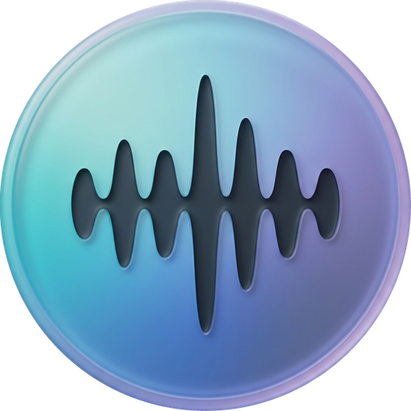

<p align="center"></p>

# MImic

A local-first Android music player: your phone's music, your own Navidrome server and your
offline downloads (plus, in the full edition, a downloader for media you're allowed to save) —
all in one player with a fully customizable look.

**Download:** [Releases](https://github.com/enoluca22-dota2/MImic/releases) — then update from
inside the app (Settings → App Updates).

## Features

- **One library, three sources** — phone music (MediaStore), your Navidrome/Subsonic server
  (LAN or Tailscale) and offline downloads; source filters and unified search. Every phone song
  shows its own artwork.
- **Dynamic Now Playing** — an optional player whose gradient, glow and controls take their colors
  from each song's artwork, with a premium seek bar and full-screen synced lyrics. The Classic,
  Immersive and Compact players stay available.
- **Cast & share** — Google Cast to Chromecast / Google TV (the phone serves the music on your
  Wi-Fi; server logins never reach the TV); share the actual audio file through Android's
  Sharesheet.
- **Radio** — live stations, Albania by default; add any country with **+**, remove with **−**
  (Settings → Radio Countries to reorder). Built-in verified Albanian stations plus the free
  Radio Browser directory; favorites, recently played, filters and search; plays in MImic's player
  with a LIVE view and Reconnect.
- **Player** — Media3 (ExoPlayer + MediaSession): background playback, notification/lock-screen
  controls, queue with resume, crossfade, ReplayGain, equalizer, speed/pitch, sleep timer with
  fade, lyrics (embedded or .lrc).
- **Downloads tab** — offline music with storage use; in the full edition also paste or share a YouTube/TikTok link → real formats → MP3/M4A
  audio or MP4 video at a chosen quality, playlists and multi-link batches, a persistent queue
  (progress, speed, ETA, pause/resume/cancel/retry), history; music lands in your library and
  plays in MImic's player, videos play in-app. Merged from the ENAGELYUCA app.
- **Design control** — Theme Studio (custom themes, JSON import/export), player layouts, liquid
  glass, home sections, library tabs.
- **Backup & Restore** — favorites, playlists, history, themes, settings and radio in one file
  you keep anywhere; restoring only adds, and works on a new phone (docs/BACKUP_FORMAT.md). No
  passwords or music in the file.
- **Library & Storage** — hide phone folders, minimum song length, refresh, and safe cache
  clearing that never touches downloads.
- **In-app updates** — Check for Updates downloads the newest release, verifies its checksum,
  package, version and **pinned signing certificate**, then Android's installer asks you to
  confirm. Stable and Beta channels; optional daily check (notification only).

## Editions

| | full | standard |
|---|---|---|
| Music player, Navidrome, offline downloads, themes, cast, share, updates | ✓ | ✓ |
| Media downloader (yt-dlp via youtubedl-android) | ✓ | — |
| Intended distribution | GitHub Releases | any store |

Both use the application ID `com.example.mimic`, so either installs over the other.

## Build

Android Studio (JDK 21 from its `jbr`), Android SDK 37.

```sh
./gradlew :app:testFullDebugUnitTest :app:testStandardDebugUnitTest
./gradlew :app:assembleFullDebug          # app/build/outputs/apk/full/debug/
```

Cloud sign-in needs your own app registrations — see [docs/CLOUD_SETUP.md](docs/CLOUD_SETUP.md).
Releases: [docs/RELEASING.md](docs/RELEASING.md). Security: [SECURITY.md](SECURITY.md).

## Legal

Download only media you own or have permission to download. MImic does not bypass DRM, paywalls
or logins. The downloader is not offered for Google Play distribution (use the standard edition
for any store). MImic is not affiliated with Google, Microsoft, YouTube, TikTok or Spotify.

## License

GPL-3.0 — see [LICENSE](LICENSE). The full edition includes
[youtubedl-android](https://github.com/JunkFood02/youtubedl-android) (GPL-3.0), yt-dlp
(Unlicense) and FFmpeg (GPL build). Other dependencies and their licenses:
[docs/DEPENDENCIES.md](docs/DEPENDENCIES.md).
